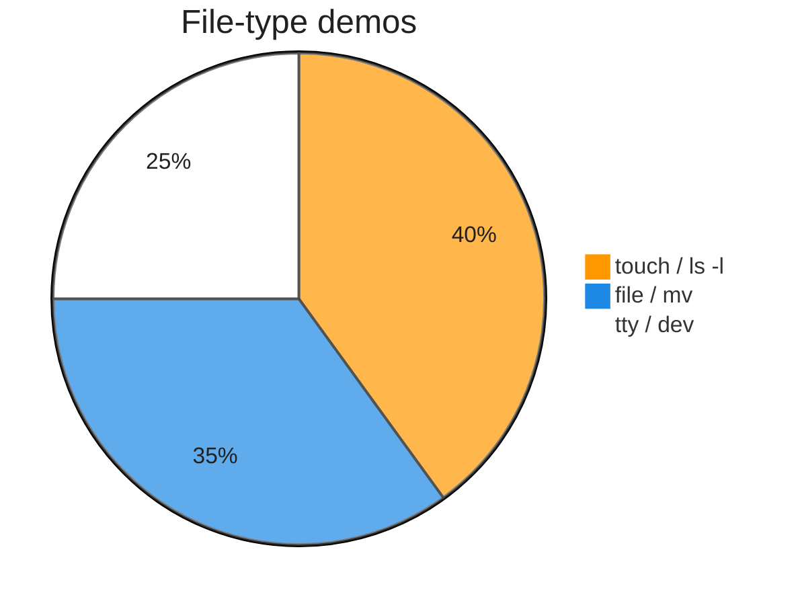

# Execution summary — `types-of-files-in-linux/`

**Topic:** [TypesOfFilesInLinux.md](../docs/topics/TypesOfFilesInLinux.md) (Video 3)  
**Scripts directory:** [`../scripts/types-of-files-in-linux/`](../scripts/types-of-files-in-linux/)



Each script section uses the same **four-part** model:

| # | Column in tables | Meaning |
| :---: | :--- | :--- |
| 1 | **What it is** | Command or shell feature (e.g. `echo` = print text). |
| 2 | **Added / configured** | How it appears in Linux (PATH, builtin, flag on CLI, variable in script). |
| 3 | **Execution intent** | What you are trying to do when the line runs. |
| 4 | **Output** | What you see on the **terminal (stdout/stderr)**, in a **file**, or through a **pipeline** (`|`). |

---

## [`file-command-content-demo.sh`](../scripts/types-of-files-in-linux/file-command-content-demo.sh)

**Run:** `bash scripts/types-of-files-in-linux/file-command-content-demo.sh`

### In-depth command walkthrough

| Command (as in script) | 1. What it is | 2. Added / configured | 3. Execution intent | 4. Output (terminal / file / pipeline) |
| :--- | :--- | :--- | :--- | :--- |
| `set -euo pipefail` | Bash strict-mode option bundle. | Written at top of script; not installed separately. | Tell Bash to stop on errors, treat unset variables as errors, and fail pipelines if any stage fails. | No visible output; changes how later commands affect exit status. |
| `WORK="${TMPDIR:-/tmp}/linux-file-command-demo"` | Shell variable assignment. | Name=`value` in script; often under `${TMPDIR:-/tmp}`. | Store path or stamp for later commands (setup, not a user command). | No output; variable used by `cd`, `rm`, file paths. |
| `rm -rf "$WORK"` | Remove files/directories recursively, force. | Coreutils; `-r` recursive, `-f` no prompt. | Clean old demo data under `/tmp` before recreating. | Silent on success. |
| `mkdir -p "$WORK"` | Make directories. | Coreutils; `-p` creates parents as needed. | Try to **create** folder(s) for the demo tree. | Silent on success; errors on stderr if path invalid. |
| `cd "$WORK"` | Change directory — move shell’s current working directory. | Builtin; takes relative or absolute path, `~`, `-`, or no args (home). | Navigate the tree (trying to **enter** a folder); relative paths start from cwd. | Normally silent on success; failure prints `cd: ...: No such file or directory` on **stderr**. |
| `touch sunny.jpg` | Create empty file or update timestamps. | Coreutils on PATH. | Try to **create** a zero-byte file or refresh mtime (Durga Sir first step). | Silent; then `ls -l` shows new file with size 0. |
| `echo "=== After touch (empty) ==="` | Section header for humans. | Literal string in script | **Print** section title | Title line on **stdout** before commands |
| `file sunny.jpg \|\| true` | Guess file type from content. | External `file` package. | Inspect type despite extension. | One descriptive line on stdout. |
| `echo "hello friends" > sunny.jpg` | Bash builtin that prints arguments to standard output. | Always available in Bash; no package install. | Show section titles, tips, or messages to the terminal (trying to **print** text for the user). | Lines appear on **stdout** in your terminal (or in CI logs). Not used in a pipeline unless followed by `|`. |
| `echo "=== After adding text content ==="` | Section header for humans. | Literal string in script | **Print** section title | Title line on **stdout** before commands |
| `file sunny.jpg` | Guess file type from content. | External `file` package. | Inspect type despite extension. | One descriptive line on stdout. |
| `cat sunny.jpg` | Concatenate and print files. | Coreutils. | Try to **display file contents** on terminal. | File bytes on stdout. |
| `mv sunny.jpg sunny.durga` | Move/rename files. | Coreutils. | Rename only; content unchanged. | Silent on success. |
| `echo "=== After mv rename (extension changed) ==="` | Section header for humans. | Literal string in script | **Print** section title | Title line on **stdout** before commands |
| `file sunny.durga` | Guess file type from content. | External `file` package. | Inspect type despite extension. | One descriptive line on stdout. |
| `ls -l` | `ls` long format. | Flag `-l` passed on command line. | Show type, permissions, owner, size, date, name. | Multiple lines on stdout. |

---

## [`tty-and-dev-demo.sh`](../scripts/types-of-files-in-linux/tty-and-dev-demo.sh)

**Run:** `bash scripts/types-of-files-in-linux/tty-and-dev-demo.sh`

### In-depth command walkthrough

| Command (as in script) | 1. What it is | 2. Added / configured | 3. Execution intent | 4. Output (terminal / file / pipeline) |
| :--- | :--- | :--- | :--- | :--- |
| `set -euo pipefail` | Bash strict-mode option bundle. | Written at top of script; not installed separately. | Tell Bash to stop on errors, treat unset variables as errors, and fail pipelines if any stage fails. | No visible output; changes how later commands affect exit status. |
| `echo "Current terminal device (tty):"` | Bash builtin that prints arguments to standard output. | Always available in Bash; no package install. | Show section titles, tips, or messages to the terminal (trying to **print** text for the user). | Lines appear on **stdout** in your terminal (or in CI logs). Not used in a pipeline unless followed by `|`. |
| `tty` | Print terminal device path. | Coreutils. | Show which `/dev/pts/N` you use. | Device path on stdout. |
| `echo ""` | Bash builtin that prints arguments to standard output. | Always available in Bash; no package install. | Show section titles, tips, or messages to the terminal (trying to **print** text for the user). | Lines appear on **stdout** in your terminal (or in CI logs). Not used in a pipeline unless followed by `|`. |
| `echo "This path is a device file under /dev — Durga Sir: communicate …` | Bash builtin that prints arguments to standard output. | Always available in Bash; no package install. | Show section titles, tips, or messages to the terminal (trying to **print** text for the user). | Lines appear on **stdout** in your terminal (or in CI logs). Not used in a pipeline unless followed by `|`. |
| `echo "Example from class (manual, needs a second open terminal):"` | Bash builtin that prints arguments to standard output. | Always available in Bash; no package install. | Show section titles, tips, or messages to the terminal (trying to **print** text for the user). | Lines appear on **stdout** in your terminal (or in CI logs). Not used in a pipeline unless followed by `|`. |
| `echo "  # On terminal 2, run: tty   → e.g. /dev/pts/1"` | Bash builtin that prints arguments to standard output. | Always available in Bash; no package install. | Show section titles, tips, or messages to the terminal (trying to **print** text for the user). | Lines appear on **stdout** in your terminal (or in CI logs). Not used in a pipeline unless followed by `|`. |
| `echo "  # On terminal 1: echo 'Hello' > /dev/pts/1"` | Bash builtin that prints arguments to standard output. | Always available in Bash; no package install. | Show section titles, tips, or messages to the terminal (trying to **print** text for the user). | Lines appear on **stdout** in your terminal (or in CI logs). Not used in a pipeline unless followed by `|`. |
| `if [[ -d /dev/pts ]]; then` | Conditional test `[[ ... ]]` or `if`. | Bash syntax. | Branch: run block only when directory exists / command succeeds. | Either block runs (messages on stdout) or `else` branch. |
| `echo ""` | Bash builtin that prints arguments to standard output. | Always available in Bash; no package install. | Show section titles, tips, or messages to the terminal (trying to **print** text for the user). | Lines appear on **stdout** in your terminal (or in CI logs). Not used in a pipeline unless followed by `|`. |
| `echo "Pseudo-terminals in /dev/pts:"` | Bash builtin that prints arguments to standard output. | Always available in Bash; no package install. | Show section titles, tips, or messages to the terminal (trying to **print** text for the user). | Lines appear on **stdout** in your terminal (or in CI logs). Not used in a pipeline unless followed by `|`. |
| `ls -l /dev/pts 2>/dev/null \| head -10` | `ls` long format. | Flag `-l` passed on command line. | Show type, permissions, owner, size, date, name. | Multiple lines on stdout. |

---

## [`types-of-files-ls-demo.sh`](../scripts/types-of-files-in-linux/types-of-files-ls-demo.sh)

**Run:** `bash scripts/types-of-files-in-linux/types-of-files-ls-demo.sh`

### In-depth command walkthrough

| Command (as in script) | 1. What it is | 2. Added / configured | 3. Execution intent | 4. Output (terminal / file / pipeline) |
| :--- | :--- | :--- | :--- | :--- |
| `set -euo pipefail` | Bash strict-mode option bundle. | Written at top of script; not installed separately. | Tell Bash to stop on errors, treat unset variables as errors, and fail pipelines if any stage fails. | No visible output; changes how later commands affect exit status. |
| `WORK="${TMPDIR:-/tmp}/linux-ls-type-demo"` | Shell variable assignment. | Name=`value` in script; often under `${TMPDIR:-/tmp}`. | Store path or stamp for later commands (setup, not a user command). | No output; variable used by `cd`, `rm`, file paths. |
| `rm -rf "$WORK"` | Remove files/directories recursively, force. | Coreutils; `-r` recursive, `-f` no prompt. | Clean old demo data under `/tmp` before recreating. | Silent on success. |
| `mkdir -p "$WORK/subdir"` | Make directories. | Coreutils; `-p` creates parents as needed. | Try to **create** folder(s) for the demo tree. | Silent on success; errors on stderr if path invalid. |
| `cd "$WORK"` | Change directory — move shell’s current working directory. | Builtin; takes relative or absolute path, `~`, `-`, or no args (home). | Navigate the tree (trying to **enter** a folder); relative paths start from cwd. | Normally silent on success; failure prints `cd: ...: No such file or directory` on **stderr**. |
| `echo "ordinary" > plain.txt` | Bash builtin that prints arguments to standard output. | Always available in Bash; no package install. | Show section titles, tips, or messages to the terminal (trying to **print** text for the user). | Lines appear on **stdout** in your terminal (or in CI logs). Not used in a pipeline unless followed by `|`. |
| `ln -s plain.txt link.txt` | Create symbolic link. | Coreutils. | Create symlink entry pointing to target. | Silent; `ls -l` shows `l` type. |
| `echo "=== ls -l in demo dir (note 1st column) ==="` | Section header for humans. | Literal string in script | **Print** section title | Title line on **stdout** before commands |
| `ls -l` | `ls` long format. | Flag `-l` passed on command line. | Show type, permissions, owner, size, date, name. | Multiple lines on stdout. |
| `echo ""` | Bash builtin that prints arguments to standard output. | Always available in Bash; no package install. | Show section titles, tips, or messages to the terminal (trying to **print** text for the user). | Lines appear on **stdout** in your terminal (or in CI logs). Not used in a pipeline unless followed by `|`. |
| `echo "Key: - = ordinary, d = directory, l = symlink"` | Bash builtin that prints arguments to standard output. | Always available in Bash; no package install. | Show section titles, tips, or messages to the terminal (trying to **print** text for the user). | Lines appear on **stdout** in your terminal (or in CI logs). Not used in a pipeline unless followed by `|`. |
| `echo ""` | Bash builtin that prints arguments to standard output. | Always available in Bash; no package install. | Show section titles, tips, or messages to the terminal (trying to **print** text for the user). | Lines appear on **stdout** in your terminal (or in CI logs). Not used in a pipeline unless followed by `|`. |
| `echo "=== Sample device entries under /dev (first lines) ==="` | Section header for humans. | Literal string in script | **Print** section title | Title line on **stdout** before commands |
| `ls -l /dev/null /dev/zero /dev/pts 2>/dev/null \| head -20 \|\| ls -l…` | `ls` long format. | Flag `-l` passed on command line. | Show type, permissions, owner, size, date, name. | Multiple lines on stdout. |

---

## [`types-of-files-touch-file-demo.sh`](../scripts/types-of-files-in-linux/types-of-files-touch-file-demo.sh)

**Run:** `bash scripts/types-of-files-in-linux/types-of-files-touch-file-demo.sh`

### In-depth command walkthrough

| Command (as in script) | 1. What it is | 2. Added / configured | 3. Execution intent | 4. Output (terminal / file / pipeline) |
| :--- | :--- | :--- | :--- | :--- |
| `set -euo pipefail` | Bash strict-mode option bundle. | Written at top of script; not installed separately. | Tell Bash to stop on errors, treat unset variables as errors, and fail pipelines if any stage fails. | No visible output; changes how later commands affect exit status. |
| `WORK="${TMPDIR:-/tmp}/linux-types-demo"` | Shell variable assignment. | Name=`value` in script; often under `${TMPDIR:-/tmp}`. | Store path or stamp for later commands (setup, not a user command). | No output; variable used by `cd`, `rm`, file paths. |
| `rm -rf "$WORK"` | Remove files/directories recursively, force. | Coreutils; `-r` recursive, `-f` no prompt. | Clean old demo data under `/tmp` before recreating. | Silent on success. |
| `mkdir -p "$WORK"` | Make directories. | Coreutils; `-p` creates parents as needed. | Try to **create** folder(s) for the demo tree. | Silent on success; errors on stderr if path invalid. |
| `cd "$WORK"` | Change directory — move shell’s current working directory. | Builtin; takes relative or absolute path, `~`, `-`, or no args (home). | Navigate the tree (trying to **enter** a folder); relative paths start from cwd. | Normally silent on success; failure prints `cd: ...: No such file or directory` on **stderr**. |
| `touch sunny.jpg` | Create empty file or update timestamps. | Coreutils on PATH. | Try to **create** a zero-byte file or refresh mtime (Durga Sir first step). | Silent; then `ls -l` shows new file with size 0. |
| `ls -l sunny.jpg` | `ls` long format. | Flag `-l` passed on command line. | Show type, permissions, owner, size, date, name. | Multiple lines on stdout. |
| `echo "Size in bytes: $(wc -c < sunny.jpg)"` | Bash builtin that prints arguments to standard output. | Always available in Bash; no package install. | Show section titles, tips, or messages to the terminal (trying to **print** text for the user). | Lines appear on **stdout** in your terminal (or in CI logs). Not used in a pipeline unless followed by `|`. |
| `file sunny.jpg \|\| true` | Guess file type from content. | External `file` package. | Inspect type despite extension. | One descriptive line on stdout. |
| `echo "Empty file: type may be 'empty' until content is added."` | Bash builtin that prints arguments to standard output. | Always available in Bash; no package install. | Show section titles, tips, or messages to the terminal (trying to **print** text for the user). | Lines appear on **stdout** in your terminal (or in CI logs). Not used in a pipeline unless followed by `|`. |

---

## Script index (all `.sh` in this summary)

| Script | Run |
| :--- | :--- |
| [`file-command-content-demo.sh`](../scripts/types-of-files-in-linux/file-command-content-demo.sh) | `bash scripts/types-of-files-in-linux/file-command-content-demo.sh` |
| [`tty-and-dev-demo.sh`](../scripts/types-of-files-in-linux/tty-and-dev-demo.sh) | `bash scripts/types-of-files-in-linux/tty-and-dev-demo.sh` |
| [`types-of-files-ls-demo.sh`](../scripts/types-of-files-in-linux/types-of-files-ls-demo.sh) | `bash scripts/types-of-files-in-linux/types-of-files-ls-demo.sh` |
| [`types-of-files-touch-file-demo.sh`](../scripts/types-of-files-in-linux/types-of-files-touch-file-demo.sh) | `bash scripts/types-of-files-in-linux/types-of-files-touch-file-demo.sh` |


**Run every script in this topic (from repo root):**

```bash
bash scripts/types-of-files-in-linux/file-command-content-demo.sh
bash scripts/types-of-files-in-linux/tty-and-dev-demo.sh
bash scripts/types-of-files-in-linux/types-of-files-ls-demo.sh
bash scripts/types-of-files-in-linux/types-of-files-touch-file-demo.sh
```
