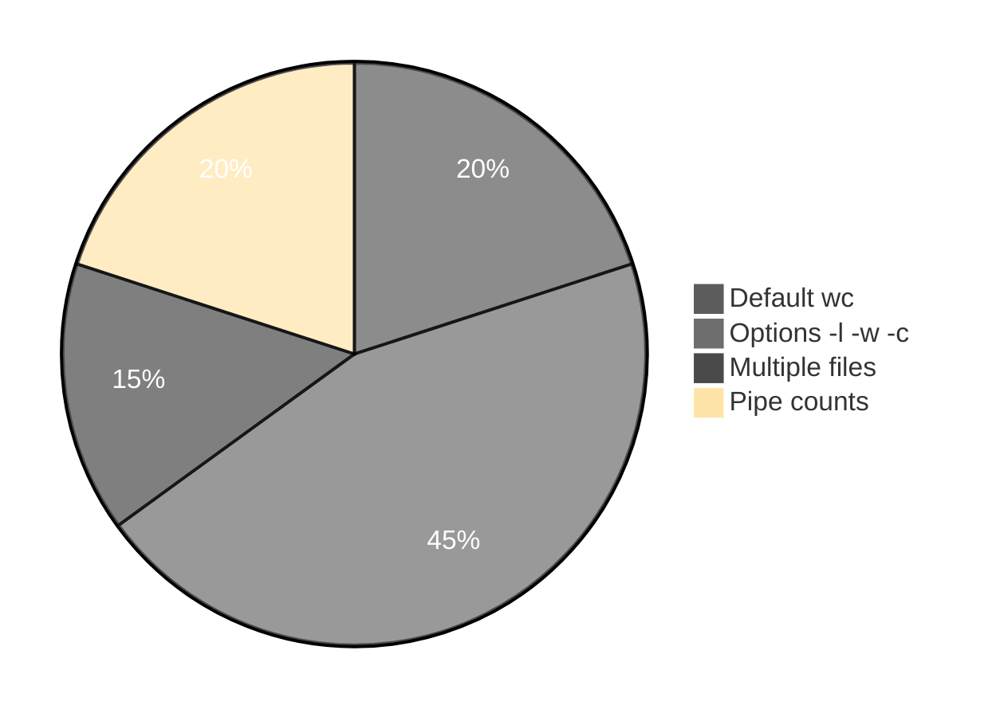

# Execution summary — `wordCountCommand/`

**Topic:** [wordCountCommand.md](../docs/topics/wordCountCommand.md) (Video 10)  
**Scripts directory:** [`../scripts/wordCountCommand/`](../scripts/wordCountCommand/)



Each script section uses the same **four-part** model:

| # | Column in tables | Meaning |
| :---: | :--- | :--- |
| 1 | **What it is** | Command or shell feature (e.g. `echo` = print text). |
| 2 | **Added / configured** | How it appears in Linux (PATH, builtin, flag on CLI, variable in script). |
| 3 | **Execution intent** | What you are trying to do when the line runs. |
| 4 | **Output** | What you see on the **terminal (stdout/stderr)**, in a **file**, or through a **pipeline** (`|`). |

---

## [`wc-bytes-chars-newline-demo.sh`](../scripts/wordCountCommand/wc-bytes-chars-newline-demo.sh)

**Run:** `bash scripts/wordCountCommand/wc-bytes-chars-newline-demo.sh`

### In-depth command walkthrough

| Command (as in script) | 1. What it is | 2. Added / configured | 3. Execution intent | 4. Output (terminal / file / pipeline) |
| :--- | :--- | :--- | :--- | :--- |
| `set -euo pipefail` | Bash strict-mode option bundle. | Written at top of script; not installed separately. | Tell Bash to stop on errors, treat unset variables as errors, and fail pipelines if any stage fails. | No visible output; changes how later commands affect exit status. |
| `echo "=== echo \"vishnu\" \| wc -c (newline adds 1 byte) ==="` | Section header for humans. | Literal string in script | **Print** section title | Title line on **stdout** before commands |
| `echo "vishnu" \| wc -c` | Bash builtin that prints arguments to standard output. | Always available in Bash; no package install. | Show section titles, tips, or messages to the terminal (trying to **print** text for the user). | Lines appear on **stdout** in your terminal (or in CI logs). Not used in a pipeline unless followed by `|`. |
| `echo ""` | Bash builtin that prints arguments to standard output. | Always available in Bash; no package install. | Show section titles, tips, or messages to the terminal (trying to **print** text for the user). | Lines appear on **stdout** in your terminal (or in CI logs). Not used in a pipeline unless followed by `|`. |
| `echo "=== echo -n \"vishnu\" \| wc -c (no trailing newline) ==="` | Section header for humans. | Literal string in script | **Print** section title | Title line on **stdout** before commands |
| `echo -n "vishnu" \| wc -c` | Bash builtin that prints arguments to standard output. | Always available in Bash; no package install. | Show section titles, tips, or messages to the terminal (trying to **print** text for the user). | Lines appear on **stdout** in your terminal (or in CI logs). Not used in a pipeline unless followed by `|`. |
| `echo ""` | Bash builtin that prints arguments to standard output. | Always available in Bash; no package install. | Show section titles, tips, or messages to the terminal (trying to **print** text for the user). | Lines appear on **stdout** in your terminal (or in CI logs). Not used in a pipeline unless followed by `|`. |
| `echo "Durga Sir: in Linux each character is normally 1 byte; \\n afte…` | Bash builtin that prints arguments to standard output. | Always available in Bash; no package install. | Show section titles, tips, or messages to the terminal (trying to **print** text for the user). | Lines appear on **stdout** in your terminal (or in CI logs). Not used in a pipeline unless followed by `|`. |

---

## [`wc-default-four-columns-demo.sh`](../scripts/wordCountCommand/wc-default-four-columns-demo.sh)

**Run:** `bash scripts/wordCountCommand/wc-default-four-columns-demo.sh`

### In-depth command walkthrough

| Command (as in script) | 1. What it is | 2. Added / configured | 3. Execution intent | 4. Output (terminal / file / pipeline) |
| :--- | :--- | :--- | :--- | :--- |
| `set -euo pipefail` | Bash strict-mode option bundle. | Written at top of script; not installed separately. | Tell Bash to stop on errors, treat unset variables as errors, and fail pipelines if any stage fails. | No visible output; changes how later commands affect exit status. |
| `WORK="${TMPDIR:-/tmp}/linux-wc-demo"` | Shell variable assignment. | Name=`value` in script; often under `${TMPDIR:-/tmp}`. | Store path or stamp for later commands (setup, not a user command). | No output; variable used by `cd`, `rm`, file paths. |
| `rm -rf "$WORK"` | Remove files/directories recursively, force. | Coreutils; `-r` recursive, `-f` no prompt. | Clean old demo data under `/tmp` before recreating. | Silent on success. |
| `mkdir -p "$WORK"` | Make directories. | Coreutils; `-p` creates parents as needed. | Try to **create** folder(s) for the demo tree. | Silent on success; errors on stderr if path invalid. |
| `cd "$WORK"` | Change directory — move shell’s current working directory. | Builtin; takes relative or absolute path, `~`, `-`, or no args (home). | Navigate the tree (trying to **enter** a folder); relative paths start from cwd. | Normally silent on success; failure prints `cd: ...: No such file or directory` on **stderr**. |
| `cat > fruits.txt <<'EOF'` | Concatenate and print files. | Coreutils. | Try to **display file contents** on terminal. | File bytes on stdout. |
| `mango` | Shell syntax (variable, test, subshell, or function). | Defined in this script only. | Prepare path, branch on failure, or wrap commands. | Depends on line: may be silent or print via embedded commands. |
| `apple` | Shell syntax (variable, test, subshell, or function). | Defined in this script only. | Prepare path, branch on failure, or wrap commands. | Depends on line: may be silent or print via embedded commands. |
| `orange` | Shell syntax (variable, test, subshell, or function). | Defined in this script only. | Prepare path, branch on failure, or wrap commands. | Depends on line: may be silent or print via embedded commands. |
| `EOF` | Shell syntax (variable, test, subshell, or function). | Defined in this script only. | Prepare path, branch on failure, or wrap commands. | Depends on line: may be silent or print via embedded commands. |
| `echo "=== wc fruits.txt (default — four fields) ==="` | Section header for humans. | Literal string in script | **Print** section title | Title line on **stdout** before commands |
| `wc fruits.txt` | Word/line/byte count. | Coreutils; `-l` lines, `-c` bytes. | Count entries or file size. | Number on stdout; `wc -l < file` reads file via stdin redirect. |
| `echo ""` | Bash builtin that prints arguments to standard output. | Always available in Bash; no package install. | Show section titles, tips, or messages to the terminal (trying to **print** text for the user). | Lines appear on **stdout** in your terminal (or in CI logs). Not used in a pipeline unless followed by `|`. |
| `echo "Durga Sir order: lines \| words \| bytes \| file name"` | Bash builtin that prints arguments to standard output. | Always available in Bash; no package install. | Show section titles, tips, or messages to the terminal (trying to **print** text for the user). | Lines appear on **stdout** in your terminal (or in CI logs). Not used in a pipeline unless followed by `|`. |

---

## [`wc-lines-only-demo.sh`](../scripts/wordCountCommand/wc-lines-only-demo.sh)

**Run:** `bash scripts/wordCountCommand/wc-lines-only-demo.sh`

### In-depth command walkthrough

| Command (as in script) | 1. What it is | 2. Added / configured | 3. Execution intent | 4. Output (terminal / file / pipeline) |
| :--- | :--- | :--- | :--- | :--- |
| `set -euo pipefail` | Bash strict-mode option bundle. | Written at top of script; not installed separately. | Tell Bash to stop on errors, treat unset variables as errors, and fail pipelines if any stage fails. | No visible output; changes how later commands affect exit status. |
| `WORK="${TMPDIR:-/tmp}/linux-wc-demo"` | Shell variable assignment. | Name=`value` in script; often under `${TMPDIR:-/tmp}`. | Store path or stamp for later commands (setup, not a user command). | No output; variable used by `cd`, `rm`, file paths. |
| `rm -rf "$WORK"` | Remove files/directories recursively, force. | Coreutils; `-r` recursive, `-f` no prompt. | Clean old demo data under `/tmp` before recreating. | Silent on success. |
| `mkdir -p "$WORK"` | Make directories. | Coreutils; `-p` creates parents as needed. | Try to **create** folder(s) for the demo tree. | Silent on success; errors on stderr if path invalid. |
| `cd "$WORK"` | Change directory — move shell’s current working directory. | Builtin; takes relative or absolute path, `~`, `-`, or no args (home). | Navigate the tree (trying to **enter** a folder); relative paths start from cwd. | Normally silent on success; failure prints `cd: ...: No such file or directory` on **stderr**. |
| `seq 1 15 > numbers.txt` | Shell syntax (variable, test, subshell, or function). | Defined in this script only. | Prepare path, branch on failure, or wrap commands. | Depends on line: may be silent or print via embedded commands. |
| `echo "=== wc numbers.txt (full) ==="` | Section header for humans. | Literal string in script | **Print** section title | Title line on **stdout** before commands |
| `wc numbers.txt` | Word/line/byte count. | Coreutils; `-l` lines, `-c` bytes. | Count entries or file size. | Number on stdout; `wc -l < file` reads file via stdin redirect. |
| `echo ""` | Bash builtin that prints arguments to standard output. | Always available in Bash; no package install. | Show section titles, tips, or messages to the terminal (trying to **print** text for the user). | Lines appear on **stdout** in your terminal (or in CI logs). Not used in a pipeline unless followed by `|`. |
| `echo "=== wc -l numbers.txt (only line count) ==="` | Section header for humans. | Literal string in script | **Print** section title | Title line on **stdout** before commands |
| `wc -l numbers.txt` | Word/line/byte count. | Coreutils; `-l` lines, `-c` bytes. | Count entries or file size. | Number on stdout; `wc -l < file` reads file via stdin redirect. |
| `echo ""` | Bash builtin that prints arguments to standard output. | Always available in Bash; no package install. | Show section titles, tips, or messages to the terminal (trying to **print** text for the user). | Lines appear on **stdout** in your terminal (or in CI logs). Not used in a pipeline unless followed by `|`. |
| `echo "Tip: when you need ONLY how many lines, use -l"` | Bash builtin that prints arguments to standard output. | Always available in Bash; no package install. | Show section titles, tips, or messages to the terminal (trying to **print** text for the user). | Lines appear on **stdout** in your terminal (or in CI logs). Not used in a pipeline unless followed by `|`. |

---

## [`wc-longest-line-capital-L-demo.sh`](../scripts/wordCountCommand/wc-longest-line-capital-L-demo.sh)

**Run:** `bash scripts/wordCountCommand/wc-longest-line-capital-L-demo.sh`

### In-depth command walkthrough

| Command (as in script) | 1. What it is | 2. Added / configured | 3. Execution intent | 4. Output (terminal / file / pipeline) |
| :--- | :--- | :--- | :--- | :--- |
| `set -euo pipefail` | Bash strict-mode option bundle. | Written at top of script; not installed separately. | Tell Bash to stop on errors, treat unset variables as errors, and fail pipelines if any stage fails. | No visible output; changes how later commands affect exit status. |
| `REPO="$(cd "$(dirname "$0")/../.." && pwd)"` | Shell syntax (variable, test, subshell, or function). | Defined in this script only. | Prepare path, branch on failure, or wrap commands. | Depends on line: may be silent or print via embedded commands. |
| `FILE="$REPO/scripts/linuxbasics/fileinfo.txt"` | Shell variable assignment. | Name=`value` in script; often under `${TMPDIR:-/tmp}`. | Store path or stamp for later commands (setup, not a user command). | No output; variable used by `cd`, `rm`, file paths. |
| `if [[ ! -f "$FILE" ]]; then` | Conditional test `[[ ... ]]` or `if`. | Bash syntax. | Branch: run block only when directory exists / command succeeds. | Either block runs (messages on stdout) or `else` branch. |
| `echo "Missing lab file: $FILE"` | Bash builtin that prints arguments to standard output. | Always available in Bash; no package install. | Show section titles, tips, or messages to the terminal (trying to **print** text for the user). | Lines appear on **stdout** in your terminal (or in CI logs). Not used in a pipeline unless followed by `|`. |
| `exit 1` | Shell syntax (variable, test, subshell, or function). | Defined in this script only. | Prepare path, branch on failure, or wrap commands. | Depends on line: may be silent or print via embedded commands. |
| `echo "=== cat fileinfo.txt (find longest line by eye) ==="` | Section header for humans. | Literal string in script | **Print** section title | Title line on **stdout** before commands |
| `cat -n "$FILE"` | Concatenate and print files. | Coreutils. | Try to **display file contents** on terminal. | File bytes on stdout. |
| `echo ""` | Bash builtin that prints arguments to standard output. | Always available in Bash; no package install. | Show section titles, tips, or messages to the terminal (trying to **print** text for the user). | Lines appear on **stdout** in your terminal (or in CI logs). Not used in a pipeline unless followed by `|`. |
| `echo "=== wc -L fileinfo.txt (longest line length in bytes) ==="` | Section header for humans. | Literal string in script | **Print** section title | Title line on **stdout** before commands |
| `wc -L "$FILE"` | Word/line/byte count. | Coreutils; `-l` lines, `-c` bytes. | Count entries or file size. | Number on stdout; `wc -l < file` reads file via stdin redirect. |
| `echo ""` | Bash builtin that prints arguments to standard output. | Always available in Bash; no package install. | Show section titles, tips, or messages to the terminal (trying to **print** text for the user). | Lines appear on **stdout** in your terminal (or in CI logs). Not used in a pipeline unless followed by `|`. |
| `echo "Remember: -l (small L) = line COUNT; -L (capital L) = longest L…` | Bash builtin that prints arguments to standard output. | Always available in Bash; no package install. | Show section titles, tips, or messages to the terminal (trying to **print** text for the user). | Lines appear on **stdout** in your terminal (or in CI logs). Not used in a pipeline unless followed by `|`. |

---

## [`wc-multiple-files-total-demo.sh`](../scripts/wordCountCommand/wc-multiple-files-total-demo.sh)

**Run:** `bash scripts/wordCountCommand/wc-multiple-files-total-demo.sh`

### In-depth command walkthrough

| Command (as in script) | 1. What it is | 2. Added / configured | 3. Execution intent | 4. Output (terminal / file / pipeline) |
| :--- | :--- | :--- | :--- | :--- |
| `set -euo pipefail` | Bash strict-mode option bundle. | Written at top of script; not installed separately. | Tell Bash to stop on errors, treat unset variables as errors, and fail pipelines if any stage fails. | No visible output; changes how later commands affect exit status. |
| `WORK="${TMPDIR:-/tmp}/linux-wc-demo"` | Shell variable assignment. | Name=`value` in script; often under `${TMPDIR:-/tmp}`. | Store path or stamp for later commands (setup, not a user command). | No output; variable used by `cd`, `rm`, file paths. |
| `rm -rf "$WORK"` | Remove files/directories recursively, force. | Coreutils; `-r` recursive, `-f` no prompt. | Clean old demo data under `/tmp` before recreating. | Silent on success. |
| `mkdir -p "$WORK"` | Make directories. | Coreutils; `-p` creates parents as needed. | Try to **create** folder(s) for the demo tree. | Silent on success; errors on stderr if path invalid. |
| `cd "$WORK"` | Change directory — move shell’s current working directory. | Builtin; takes relative or absolute path, `~`, `-`, or no args (home). | Navigate the tree (trying to **enter** a folder); relative paths start from cwd. | Normally silent on success; failure prints `cd: ...: No such file or directory` on **stderr**. |
| `echo "alpha" > a.txt` | Bash builtin that prints arguments to standard output. | Always available in Bash; no package install. | Show section titles, tips, or messages to the terminal (trying to **print** text for the user). | Lines appear on **stdout** in your terminal (or in CI logs). Not used in a pipeline unless followed by `|`. |
| `echo "beta gamma" > b.txt` | Bash builtin that prints arguments to standard output. | Always available in Bash; no package install. | Show section titles, tips, or messages to the terminal (trying to **print** text for the user). | Lines appear on **stdout** in your terminal (or in CI logs). Not used in a pipeline unless followed by `|`. |
| `echo "=== wc a.txt b.txt (per file + total) ==="` | Section header for humans. | Literal string in script | **Print** section title | Title line on **stdout** before commands |
| `wc a.txt b.txt` | Word/line/byte count. | Coreutils; `-l` lines, `-c` bytes. | Count entries or file size. | Number on stdout; `wc -l < file` reads file via stdin redirect. |

---

## [`wc-pipe-count-demo.sh`](../scripts/wordCountCommand/wc-pipe-count-demo.sh)

**Run:** `bash scripts/wordCountCommand/wc-pipe-count-demo.sh`

### In-depth command walkthrough

| Command (as in script) | 1. What it is | 2. Added / configured | 3. Execution intent | 4. Output (terminal / file / pipeline) |
| :--- | :--- | :--- | :--- | :--- |
| `set -euo pipefail` | Bash strict-mode option bundle. | Written at top of script; not installed separately. | Tell Bash to stop on errors, treat unset variables as errors, and fail pipelines if any stage fails. | No visible output; changes how later commands affect exit status. |
| `echo "=== ls /etc \| wc -l (how many names — includes . and .. on some…` | Section header for humans. | Literal string in script | **Print** section title | Title line on **stdout** before commands |
| `ls /etc \| wc -l` | List directory contents. | Coreutils; options change columns, hidden files, sort. | Try to **show names** in cwd or given path. | Names on stdout; options add permissions, sizes, inodes. |
| `echo ""` | Bash builtin that prints arguments to standard output. | Always available in Bash; no package install. | Show section titles, tips, or messages to the terminal (trying to **print** text for the user). | Lines appear on **stdout** in your terminal (or in CI logs). Not used in a pipeline unless followed by `|`. |
| `echo "=== printf 'one\\ntwo\\nthree\\n' \| wc -l ==="` | Section header for humans. | Literal string in script | **Print** section title | Title line on **stdout** before commands |
| `printf 'one\ntwo\nthree\n' \| wc -l` | Formatted print (builtin). | Bash builtin. | Print with format specifiers like C. | Formatted bytes on stdout. |
| `echo ""` | Bash builtin that prints arguments to standard output. | Always available in Bash; no package install. | Show section titles, tips, or messages to the terminal (trying to **print** text for the user). | Lines appear on **stdout** in your terminal (or in CI logs). Not used in a pipeline unless followed by `|`. |
| `echo "Pipe sends stdout to wc; file name shows as input or is omitted."` | Bash builtin that prints arguments to standard output. | Always available in Bash; no package install. | Show section titles, tips, or messages to the terminal (trying to **print** text for the user). | Lines appear on **stdout** in your terminal (or in CI logs). Not used in a pipeline unless followed by `|`. |

---

## [`wc-words-only-demo.sh`](../scripts/wordCountCommand/wc-words-only-demo.sh)

**Run:** `bash scripts/wordCountCommand/wc-words-only-demo.sh`

### In-depth command walkthrough

| Command (as in script) | 1. What it is | 2. Added / configured | 3. Execution intent | 4. Output (terminal / file / pipeline) |
| :--- | :--- | :--- | :--- | :--- |
| `set -euo pipefail` | Bash strict-mode option bundle. | Written at top of script; not installed separately. | Tell Bash to stop on errors, treat unset variables as errors, and fail pipelines if any stage fails. | No visible output; changes how later commands affect exit status. |
| `WORK="${TMPDIR:-/tmp}/linux-wc-demo"` | Shell variable assignment. | Name=`value` in script; often under `${TMPDIR:-/tmp}`. | Store path or stamp for later commands (setup, not a user command). | No output; variable used by `cd`, `rm`, file paths. |
| `rm -rf "$WORK"` | Remove files/directories recursively, force. | Coreutils; `-r` recursive, `-f` no prompt. | Clean old demo data under `/tmp` before recreating. | Silent on success. |
| `mkdir -p "$WORK"` | Make directories. | Coreutils; `-p` creates parents as needed. | Try to **create** folder(s) for the demo tree. | Silent on success; errors on stderr if path invalid. |
| `cd "$WORK"` | Change directory — move shell’s current working directory. | Builtin; takes relative or absolute path, `~`, `-`, or no args (home). | Navigate the tree (trying to **enter** a folder); relative paths start from cwd. | Normally silent on success; failure prints `cd: ...: No such file or directory` on **stderr**. |
| `printf 'hello world\nlinux basics\nwc command\n' > sample.txt` | Formatted print (builtin). | Bash builtin. | Print with format specifiers like C. | Formatted bytes on stdout. |
| `echo "=== wc sample.txt (full) ==="` | Section header for humans. | Literal string in script | **Print** section title | Title line on **stdout** before commands |
| `wc sample.txt` | Word/line/byte count. | Coreutils; `-l` lines, `-c` bytes. | Count entries or file size. | Number on stdout; `wc -l < file` reads file via stdin redirect. |
| `echo ""` | Bash builtin that prints arguments to standard output. | Always available in Bash; no package install. | Show section titles, tips, or messages to the terminal (trying to **print** text for the user). | Lines appear on **stdout** in your terminal (or in CI logs). Not used in a pipeline unless followed by `|`. |
| `echo "=== wc -w sample.txt (only word count) ==="` | Section header for humans. | Literal string in script | **Print** section title | Title line on **stdout** before commands |
| `wc -w sample.txt` | Word/line/byte count. | Coreutils; `-l` lines, `-c` bytes. | Count entries or file size. | Number on stdout; `wc -l < file` reads file via stdin redirect. |
| `echo ""` | Bash builtin that prints arguments to standard output. | Always available in Bash; no package install. | Show section titles, tips, or messages to the terminal (trying to **print** text for the user). | Lines appear on **stdout** in your terminal (or in CI logs). Not used in a pipeline unless followed by `|`. |
| `echo "Word = text separated by spaces (whitespace)"` | Bash builtin that prints arguments to standard output. | Always available in Bash; no package install. | Show section titles, tips, or messages to the terminal (trying to **print** text for the user). | Lines appear on **stdout** in your terminal (or in CI logs). Not used in a pipeline unless followed by `|`. |

---

## Script index (all `.sh` in this summary)

| Script | Run |
| :--- | :--- |
| [`wc-bytes-chars-newline-demo.sh`](../scripts/wordCountCommand/wc-bytes-chars-newline-demo.sh) | `bash scripts/wordCountCommand/wc-bytes-chars-newline-demo.sh` |
| [`wc-default-four-columns-demo.sh`](../scripts/wordCountCommand/wc-default-four-columns-demo.sh) | `bash scripts/wordCountCommand/wc-default-four-columns-demo.sh` |
| [`wc-lines-only-demo.sh`](../scripts/wordCountCommand/wc-lines-only-demo.sh) | `bash scripts/wordCountCommand/wc-lines-only-demo.sh` |
| [`wc-longest-line-capital-L-demo.sh`](../scripts/wordCountCommand/wc-longest-line-capital-L-demo.sh) | `bash scripts/wordCountCommand/wc-longest-line-capital-L-demo.sh` |
| [`wc-multiple-files-total-demo.sh`](../scripts/wordCountCommand/wc-multiple-files-total-demo.sh) | `bash scripts/wordCountCommand/wc-multiple-files-total-demo.sh` |
| [`wc-pipe-count-demo.sh`](../scripts/wordCountCommand/wc-pipe-count-demo.sh) | `bash scripts/wordCountCommand/wc-pipe-count-demo.sh` |
| [`wc-words-only-demo.sh`](../scripts/wordCountCommand/wc-words-only-demo.sh) | `bash scripts/wordCountCommand/wc-words-only-demo.sh` |


**Run every script in this topic (from repo root):**

```bash
bash scripts/wordCountCommand/wc-bytes-chars-newline-demo.sh
bash scripts/wordCountCommand/wc-default-four-columns-demo.sh
bash scripts/wordCountCommand/wc-lines-only-demo.sh
bash scripts/wordCountCommand/wc-longest-line-capital-L-demo.sh
bash scripts/wordCountCommand/wc-multiple-files-total-demo.sh
bash scripts/wordCountCommand/wc-pipe-count-demo.sh
bash scripts/wordCountCommand/wc-words-only-demo.sh
```
