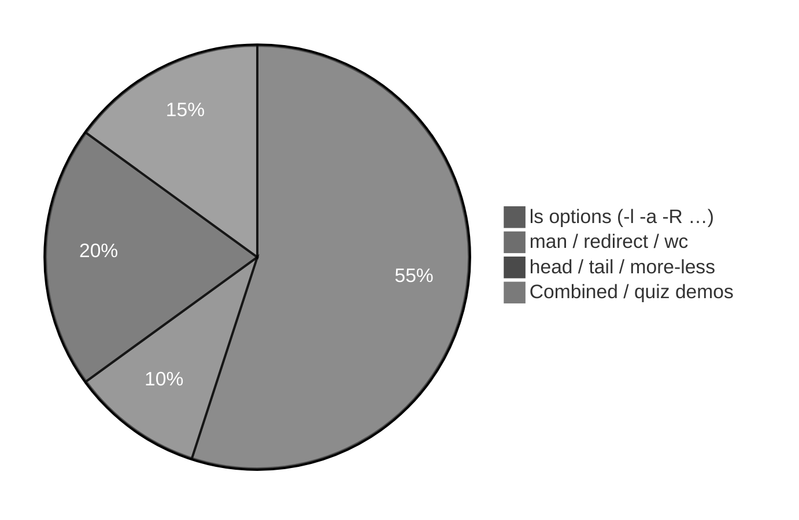

# Execution summary — `ls-command-and-its-options/`

**Topic:** [ls Command and its options.md](../../docs/topics/ls%20Command%20and%20its%20options.md) (Video 7)  
**Scripts directory:** [`../ls-command-and-its-options/`](../ls-command-and-its-options/)

---

## [`ls-basic-and-directory-arg-demo.sh`](../ls-command-and-its-options/ls-basic-and-directory-arg-demo.sh)

| Command | Meaning |
| :--- | :--- |
| `mkdir -p`, `cd`, `echo >`, `chmod +x` | Build sample `scripts/` tree |
| `ls` | List **cwd** (alphabetical) |
| `ls scripts` | List **named directory** |

---

## [`man-ls-redirect-wc-demo.sh`](../ls-command-and-its-options/man-ls-redirect-wc-demo.sh)

| Command | Meaning |
| :--- | :--- |
| `man ls` | Manual ( **`q`** to quit when interactive) |
| `man ls > file` | Redirect stdout to file |
| `wc -l < file` | Count lines |
| `ls --help` | Fallback if `man` missing |

---

## [`ls-r-reverse-alphabetical-demo.sh`](../ls-command-and-its-options/ls-r-reverse-alphabetical-demo.sh)

| Command | Meaning |
| :--- | :--- |
| `mkdir` (several names) | Fake home-style folders |
| `ls` | A→Z order |
| `ls -r` | Z→A order |

---

## [`ls-l-long-listing-demo.sh`](../ls-command-and-its-options/ls-l-long-listing-demo.sh)

| Command | Meaning |
| :--- | :--- |
| `echo >` | Create sample files |
| `ls -l` | Long format (type, perms, links, owner, group, size, time, name) |

---

## [`ls-lt-ltr-time-sort-demo.sh`](../ls-command-and-its-options/ls-lt-ltr-time-sort-demo.sh)

| Command | Meaning |
| :--- | :--- |
| `touch`, `sleep` | Different mtimes |
| `ls -l` | Alphabetical |
| `ls -lt` | Newest first |
| `ls -ltr` | Oldest first |

---

## [`ls-a-vs-A-hidden-demo.sh`](../ls-command-and-its-options/ls-a-vs-A-hidden-demo.sh)

| Command | Meaning |
| :--- | :--- |
| `touch .hidden_rc` | Hidden dotfile |
| `ls`, `ls -a`, `ls -A` | Compare visibility |
| `wc -l` | Count entries |

---

## [`ls-F-classify-demo.sh`](../ls-command-and-its-options/ls-F-classify-demo.sh)

| Command | Meaning |
| :--- | :--- |
| `chmod +x`, `ln -s` | Executable + symlink |
| `ls -F` | `/` `*` `@` suffixes |
| `ls -F /bin` | System binaries sample |

---

## [`ls-f-no-color-demo.sh`](../ls-command-and-its-options/ls-f-no-color-demo.sh)

| Command | Meaning |
| :--- | :--- |
| `ls --color=auto` | Colored listing (if supported) |
| `ls -f` | No color; GNU lists unsorted |

---

## [`ls-i-inode-demo.sh`](../ls-command-and-its-options/ls-i-inode-demo.sh)

| Command | Meaning |
| :--- | :--- |
| `ls -i` | Inode + name |
| `ls -li` | Long + inode |

---

## [`ls-R-recursive-demo.sh`](../ls-command-and-its-options/ls-R-recursive-demo.sh)

| Command | Meaning |
| :--- | :--- |
| `ls scripts` | No inner files of `jj/` |
| `ls -R` | Recursive tree |

---

## [`ls-s-and-lh-size-demo.sh`](../ls-command-and-its-options/ls-s-and-lh-size-demo.sh)

| Command | Meaning |
| :--- | :--- |
| `ls -s` | Block sizes |
| `ls -ls` | Long + blocks |
| `ls -lh` | Human-readable |
| `ls -l file` | Bytes in 5th column |

---

## [`ls-combined-options-quiz-demo.sh`](../ls-command-and-its-options/ls-combined-options-quiz-demo.sh)

| Command | Meaning |
| :--- | :--- |
| `ls -ai` | All + inode |
| `ls -lAtr` | Long, almost-all, time, oldest first |
| `ls -r` vs `ls -ltr` | Show they differ |

---

## [`ls-with-head-tail-demo.sh`](../ls-command-and-its-options/ls-with-head-tail-demo.sh)

| Command | Meaning |
| :--- | :--- |
| `ls -l /etc` | Large listing |
| `wc -l` | Count lines |
| `head`, `head -3`, `tail`, `tail -3` | Top/bottom rows |

---

## [`ls-with-more-less-hint-demo.sh`](../ls-command-and-its-options/ls-with-more-less-hint-demo.sh)

| Command | Meaning |
| :--- | :--- |
| `echo` | Documents `more` / `less` usage |
| `head -25` | Non-interactive preview |

---

## Quick reference — all scripts

| Script | Key commands |
| :--- | :--- |
| [`ls-basic-and-directory-arg-demo.sh`](../ls-command-and-its-options/ls-basic-and-directory-arg-demo.sh) | `ls`, `ls dir` |
| [`man-ls-redirect-wc-demo.sh`](../ls-command-and-its-options/man-ls-redirect-wc-demo.sh) | `man`, `>`, `wc -l` |
| [`ls-r-reverse-alphabetical-demo.sh`](../ls-command-and-its-options/ls-r-reverse-alphabetical-demo.sh) | `ls -r` |
| [`ls-l-long-listing-demo.sh`](../ls-command-and-its-options/ls-l-long-listing-demo.sh) | `ls -l` |
| [`ls-lt-ltr-time-sort-demo.sh`](../ls-command-and-its-options/ls-lt-ltr-time-sort-demo.sh) | `ls -lt`, `ls -ltr` |
| [`ls-a-vs-A-hidden-demo.sh`](../ls-command-and-its-options/ls-a-vs-A-hidden-demo.sh) | `ls -a`, `ls -A` |
| [`ls-F-classify-demo.sh`](../ls-command-and-its-options/ls-F-classify-demo.sh) | `ls -F` |
| [`ls-f-no-color-demo.sh`](../ls-command-and-its-options/ls-f-no-color-demo.sh) | `ls -f` |
| [`ls-i-inode-demo.sh`](../ls-command-and-its-options/ls-i-inode-demo.sh) | `ls -i` |
| [`ls-R-recursive-demo.sh`](../ls-command-and-its-options/ls-R-recursive-demo.sh) | `ls -R` |
| [`ls-s-and-lh-size-demo.sh`](../ls-command-and-its-options/ls-s-and-lh-size-demo.sh) | `ls -s`, `ls -lh` |
| [`ls-combined-options-quiz-demo.sh`](../ls-command-and-its-options/ls-combined-options-quiz-demo.sh) | combined flags |
| [`ls-with-head-tail-demo.sh`](../ls-command-and-its-options/ls-with-head-tail-demo.sh) | `head`, `tail` |
| [`ls-with-more-less-hint-demo.sh`](../ls-command-and-its-options/ls-with-more-less-hint-demo.sh) | pager hints |
